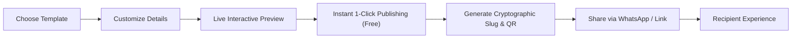

# HeartCraft — Interactive Digital Greeting & Surprise Platform

> **"Make every moment unforgettable."**  
> A full-stack commercial web application inspired by MyHeartCraft.com, strictly architected with **Low-Level Design (LLD)**, **SOLID principles**, and **design patterns**.
> **100% Free & Instant Access**: Zero paywalls, zero checkout friction. Create, preview, publish, and share emotional interactive moments freely.

---

## 🏛️ Architecture & SOLID Principles

### 1. Single Responsibility Principle (SRP)
- **Controllers** (`backend/controllers/`): Only handle HTTP requests, extract parameters, and format JSON responses.
- **Services** (`backend/services/`): Handle domain business logic (`cardService`, `qrService`, `emailService`).
- **Repositories & Models** (`backend/models/`): Encapsulate data access and queries for their respective entities (`User`, `Card`, `Template`, `Media`).
- **Middlewares** (`backend/middleware/`): Manage cross-cutting concerns (JWT authentication, role authorization, validation, error handling).

### 2. Open/Closed Principle (OCP)
- **Experience Factory & Registry** (`frontend/src/experiences/ExperienceRenderer.jsx`): Introduce new celebration themes (Graduation, Valentine, Baby Shower) simply by registering the component without modifying core routing or recipient delivery containers.
- **Storage Strategy** (`IStorageProvider`): Cloudinary and Local disk storage implementations.

### 3. Liskov Substitution Principle (LSP)
- Any implementation of `IStorageProvider` can substitute another seamlessly.
- All experience views conform to the uniform interface contract: `({ card, isPreview }) => JSX.Element`.

### 4. Interface Segregation Principle (ISP)
- Discrete, focused interfaces for `qrService`, `emailService`, and `cardService`.
- Frontend custom hooks and utility engines (`soundEffects.js`) are separated by concern.

### 5. Dependency Inversion Principle (DIP)
- High-level business services do not depend directly on database drivers. They depend on the unified `IDatabaseAdapter` interface, which supports production MySQL as well as the local relational persistent engine.

---

## 🎨 Design Patterns Implemented

| Pattern | Location | Purpose |
| :--- | :--- | :--- |
| **Factory Pattern** | `frontend/src/experiences/ExperienceRenderer.jsx` | Resolves the exact interactive experience based on template category. |
| **Repository Pattern** | `backend/models/*.js` | Encapsulates all relational queries and entity lifecycle management. |
| **Builder Pattern** | `backend/services/cardService.js` | Validates and constructs card drafts with optional passcodes and countdowns. |
| **Storage Strategy** | `backend/config/cloudinary.js` | Factory yielding either Cloudinary or local disk storage. |

---

## 🚀 Customer Journey Workflow



---

## 🎈 Interactive Recipient Experiences

1. **Birthday Experience (`/birthday`, `/card/:slug`)**:
   - Opening gift unbox animation.
   - Virtual floating balloons that pop with realistic sound effects and particle bursts on tap.
   - 3D-styled cake with burning candles.
   - Interactive candle blow-out interaction (extinguishes flames with whoosh sound).
   - Interactive cake-cutting knife animation with slicing sound.
   - Personalized unfolding letter with handwriting typography and photos.
   - Optional 4-digit PIN lock gate and live countdown timer.

2. **Proposal Experience (`/proposal`)**:
   - Romantic landing page with floating rose petals.
   - Personalized proposal question ("Will you marry me, Priya?").
   - "Yes" and "No" buttons with an **evasive, jumping "No" button** that dodges the cursor with humorous quips while the "Yes" button grows bigger!
   - Confetti blast, celebratory romantic melody, and personal vow letter when "Yes" is selected.

3. **Anniversary Experience (`/anniversary`)**:
   - Couple's names and anniversary date.
   - Live relationship counter (calculates exact Years, Months, Days, Hours, Minutes, Seconds together in real-time).
   - Milestone memory timeline and photo gallery.

4. **Sorry Experience (`/sorry`)**:
   - Vintage wax-sealed envelope.
   - Clicking breaks the wax seal and smoothly slides out heartfelt apology note cards.
   - "I forgive you" interaction with reconciliation celebration.

5. **Photo Puzzle Experience (`/puzzle`)**:
   - Scrambled 3x3 interactive sliding/swap tile puzzle of custom uploaded photo.
   - Move counter and victory fanfare unveiling a secret hidden message!

6. **Friendship Experience (`/friendship`)**:
   - Bestie polaroids memory board with pins.
   - Interactive unboxable inside joke box and personal letter.

---

## 📦 Project Structure

```
love Craft/
├── backend/
│   ├── config/
│   │   ├── database.js          # Unified relational DB adapter (MySQL + Local SQLite)
│   │   ├── cloudinary.js        # Storage Strategy
│   │   └── schema.sql           # Full MySQL 8.0 DDL Schema
│   ├── controllers/             # HTTP presentation layer (auth, card, template, admin)
│   ├── middleware/              # Auth guard, admin guard, error middleware, multer upload
│   ├── models/                  # Repository Layer (User, Card, Template, Media)
│   ├── routes/                  # Express REST routes
│   ├── services/                # Business services (card, email, qr)
│   ├── tests/                   # LLD and unit tests
│   ├── utils/                   # Crypto utils (slug generator, bcrypt)
│   ├── server.js                # Server entrypoint
│   └── .env                     # Configuration
├── frontend/
│   ├── src/
│   │   ├── admin/               # Admin dashboard, templates, customer views
│   │   ├── components/          # Navbar, Footer, Hero, ExperienceCard, Carousel, HowItWorks, Reviews
│   │   ├── context/             # AuthContext (JWT session management)
│   │   ├── creator/             # StyleSelector, CustomizationForm, PhotoUploader, LetterEditor, MusicSelector
│   │   ├── experiences/         # Interactive templates (Birthday, Proposal, Anniversary, Sorry, Puzzle, Friendship)
│   │   ├── pages/               # Routing pages (Home, Product pages, Preview, Success, Recipient)
│   │   ├── services/            # Frontend API client
│   │   ├── utils/               # Native Web Audio sound synthesis engine
│   │   └── App.jsx              # Main router & providers
│   ├── tailwind.config.js       # Design system colors, fonts & keyframe animations
│   └── vite.config.js           # Vite dev server & backend API proxy
└── package.json                 # Monorepo management scripts
```

---

## 🛠️ How to Run Locally

### 1. Start the Backend API Server
```bash
# In the root directory or inside backend/:
cd backend
npm run dev
# OR from root:
npm run dev:backend
```
Backend runs at: **`http://localhost:5000`**

### 2. Start the Frontend Application
```bash
# In a new terminal:
cd frontend
npm run dev
# OR from root:
npm run dev:frontend
```
Frontend runs at: **`http://localhost:5173`**

### 3. Run Automated LLD & SOLID Tests
```bash
node backend/tests/unit_and_lld.test.js
```

---

## 🔑 Demo & Admin Credentials

| Role | Email | Password | Access |
| :--- | :--- | :--- | :--- |
| **Admin** | `admin@heartcraft.com` | `Admin@123` | Full access to `/admin` dashboard, templates catalog, and platform metrics |
| **Customer** | `sarah@example.com` | `Secret@123` | Card creation, instant free publishing, and share link management |

*(Quick-fill buttons are provided on `/login` for instantaneous testing).*
